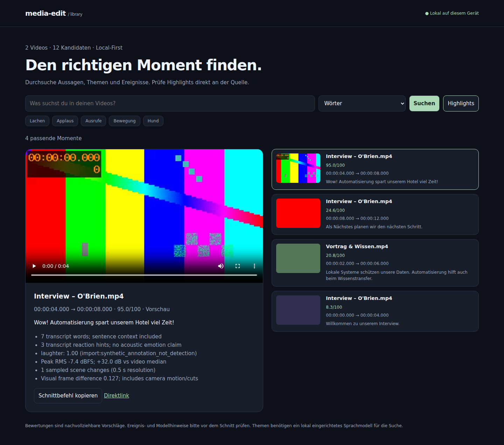

# Ausgeführte Prüfungen und verbleibende Qualitätsfragen

Stand: 18.10.2026. Linux x86_64, Python 3.12.14, SQLite 3.53.1, FFmpeg 6.1.1.
Optionale Kompatibilitätsprüfung mit Torch 2.14.1+cpu, Transformers 5.20.1, Sentence Transformers 6.1.0,
NumPy 2.5.4, Pillow 13.0.0 und PySceneDetect 0.7.2. Auf diesem Executor steht kein Apple-Silicon-Gerät zur Verfügung.

## Automatisierte Prüfungen

```bash
python3 -W error::ResourceWarning -m unittest discover -s tests -v
bash -n media-edit.sh install.sh uninstall.sh
shellcheck media-edit.sh install.sh uninstall.sh
ruff check media_index tests examples
uv lock --check
```

**20 Tests bestanden** in der Umgebung mit optionalen Modellpaketen; ein protokollierter kompletter Lauf 9,520 s.
Ohne diese Extras werden die vier optionalen Modelltests übersprungen. Die 16 Core-Tests benötigen nur die Standardbibliothek und FFmpeg.
ShellCheck, Shell-Syntax, Ruff, Lock-Konsistenz und `git diff --check` bestanden.
Die Shell-Routen, `me_info`, `me_help` und `media-edit library doctor` wurden ausgeführt.

Die Tests prüfen übergreifende Wortsuche, Original-Wortmarken, Zeitlinks, Ereignisherkunft, Szenen-/Lautstärkesignale,
unveränderte Quelldateien, übersprungene unveränderte Videos, Ersetzen von FTS-Einträgen, Erhalt des alten Index bei Fehlern,
Batch-Fortsetzung nach einer defekten Datei, fehlende Audiospuren, verzögerte Audio-Startzeiten,
echte JPEG-/MP4-Erzeugung, Schnittlisten je Quelle, Video-Byte-Ranges, MP4-/WebM-Fallback-Endpunkte und registrierte Medienpfade.
Semantiktests weisen Modell-Snapshot-Mischung zurück. Transkriptimporte decken SRT, VTT und whisper.cpp-Millisekunden ab.

Die optionalen Tests erzeugen **winzige zufällige lokale Modelle** und prüfen tatsächliche Bibliotheksaufrufe:
AST/Sigmoid, Emotionsklassen/Softmax, CLIP/PIL sowie Query-/Dokument-Encoding und Normalisierung.
Ein Parakeet-Vertragstest prüft Modellwiederverwendung, Chunking und den Erhalt von Tokenmarken mit einem Test-Double.
Das ist kein ausgeführter Parakeet-Inferenztest auf Apple Silicon.

## End-to-End mit annotierten Testvideos

```bash
python3 examples/local_search_demo.py --out demo-output
```

Zwei erzeugte Videos, 12 und 8 Sekunden lang, mit synthetischen Bildern/Tönen und ausdrücklich mitgelieferten Annotationen:

| Beobachtung | Tatsächliches Ergebnis |
|---|---|
| Wortsuche `Automatisierung` | Treffer in beiden Videos |
| Ereignissuche `lachen` | Treffer mit Quelle `import:synthetic_annotation_not_detection` |
| Szenenwechsel | Basisdetektor findet 4,0 und 8,0 s |
| Optionaler AdaptiveDetector | Ebenfalls 4,0 und 8,0 s, als eigene Detektorquelle gespeichert |
| Highlight-Auswahl | Reaktionsfenster um die annotierte Stelle enthält ein hoch bewertetes Ergebnis |
| Export | Drei echte JPEGs/MP4s, JSON-Marken, je Quellvideo CSV und lokales HTML |
| Dauer der MP4-Vorschauen | Mit ffprobe innerhalb 0,15 s der ausgewählten Zeitspanne geprüft |

Ein aktueller Core-Lauf benötigte 0,337 + 0,277 s für die Analyse der zwei kurzen Videos, ohne Fixture-Erzeugung/Export.
Der separate adaptive Lauf benötigte 0,679 + 0,437 s. Das sind Debug-Messungen auf einem winzigen Bestand und keine Vorhersage für Archivmaterial.
Die mitgelieferte Lacher-Annotation ist ein Verarbeitungstest, kein Nachweis akustischer Lacherkennung.

## Tatsächliche Inferenz mit vortrainierten Gewichten

Die Gewichte wurden separat für die Prüfung bereitgestellt. Der Analysepfad lädt sie nur lokal.
`examples/local_asr_smoke.py` erzeugt zwei englische `flite`-Sprachvideos ohne Transkript-Sidecars:
eine Aussage zu Hotel-Automatisierung und eine Aussage zu Hunden im Wald.

```bash
python3 examples/local_asr_smoke.py \
  --model-path /lokal/faster-whisper-tiny \
  --semantic-model /lokal/all-MiniLM-L6-v2
```

Ausgeführt mit `Systran/faster-whisper-tiny` und `sentence-transformers/all-MiniLM-L6-v2`:

- Beide Videos wurden über faster-whisper, CPU/int8 und VAD erfolgreich erkannt und indexiert.
- Die Suche `hotel` fand das Hotelvideo. Die erkannte Wortspanne war **0,58–0,88 s**.
- Die sinngemäße Frage `Improving productivity in guest accommodation` platzierte das Hotelvideo vor dem Hundevideo.
- Beobachtete Kosinus-Ähnlichkeiten: **0,33761** für Hotel, **−0,02915** für Hunde. Das sind keine Qualitätswahrscheinlichkeiten.
- Indexierung: 5,406 s für das erste 3,790-s-Video inklusive Modellaufbau; 0,892 s für das zweite 5,150-s-Video mit wiederverwendeten Modellen.

Dieser Test deckte einen realen Kompatibilitätsfehler auf: faster-whisper 1.2.1 ruft beim dateibasierten Decode `av.open(metadata_errors=…)` auf,
was mit PyAV 19 scheitert. Der Adapter übergibt jetzt das bereits extrahierte Mono-16-kHz-PCM als NumPy-Array an die ASR-API.
Der anschließende vollständige Inferenzlauf und ein gezielter Regressionstest bestanden.
Die Aussagekraft bleibt auf diese zwei sauberen, synthetischen englischen Äußerungen begrenzt.

## Browser-Prüfung

Mit Playwright und Chromium Headless 140 tatsächlich geprüft: vier anfängliche Highlight-Karten,
zwei videobestandsübergreifende Worttreffer, ein Lacher-Treffer, Wiedergabe, leere Suchergebnisse ohne alte Auswahl,
Rückkehr zu Highlights sowie Ansichten mit 1440 und 390 Pixel Breite. Keine JavaScript-Laufzeitfehler und kein horizontales Überlaufen.
Der Chromium-Build konnte H.264 nicht dekodieren; genau dadurch wurde der lokale WebM-Fallback mit tatsächlicher Wiedergabe geprüft.
VP9/Opus ergänzen MP4 für diesen Fall. Die exportierten MP4-Dateien wurden zusätzlich mit ffprobe geprüft.



## Was mit einem echten Bestand geprüft werden muss

| Qualitätsfrage | Konkrete Prüfung |
|---|---|
| Deutsch, Dialekt, Kinderstimmen, Fachbegriffe | 20–50 repräsentative Ausschnitte manuell transkribieren; WER/CER sowie Eigennamen vergleichen. Parakeet v3 gegen MLX Whisper und ggf. Qwen-ASR testen. |
| Zeitmarken und Synchronität | Wort-/Ereignis-Onsets manuell markieren; Median und 95. Perzentil der Abweichung messen. VFR, versetzte Tonspuren und lange Clips einbeziehen. |
| Akustisches Lachen / Applaus | Annotierte positive und negative Beispiele, Musik und Hintergrundpublikum. Präzision/Recall pro Ereignis, Schwellenwerte und 5-s-Fenster prüfen. |
| Sprach-Emotionen | Sprache, Aufnahmeart und Klassendefinition prüfen; keine unverifizierten Modell-Scores als psychologische Tatsachen übernehmen. |
| Bilder und Bewegung | Hunde, Landschaften, Bildschirme, Dunkelheit und Kameraschwenks markieren; falsche CLIP-Tags und Bewegungsalarme zählen. |
| Suchnutzen | 20 reale Wort-/Themen-/Ereignisfragen festlegen; Trefferquote in den Top 5 und Zeit bis zum passenden Ausschnitt messen. |
| Highlight-Nutzen | Top 10 pro Anwendungsfall bewerten: verwendbar, Kontext vollständig, Anfang/Ende sauber, Redundanz gering. Gegen den bisherigen lautesten Ausschnitt vergleichen. |
| Apple Silicon | Parakeet/MLX tatsächlich auf M4 Max ausführen; CPU/MPS-Adapter, Unified Memory, Temperatur, Laufzeit und Wiederaufnahme bei langen Videos prüfen. |
| Gemischte Archive / Schnittprogramme | MOV/HEVC/MKV/VFR, Langvideos, externe Datenträger, Browser und LosslessCut-Import mit echten Quellen testen. Editor-native Timelines sind noch kein Bestandteil. |
| Größenordnung | Stunden/Tage an Material, DB-/Cache-Wachstum und p95-Suchlatenz messen. Erst danach ANN-Index oder zusätzliche Worker dimensionieren. |

Der Prototyp enthält keinen gemessenen Qualitätsgewinn gegenüber Opus Clip, keine validierte Viralitätsprognose,
keinen vollständigen deutschen Emotionsbenchmark und keine automatische Auswahl garantiert veröffentlichungsreifer Storys.
